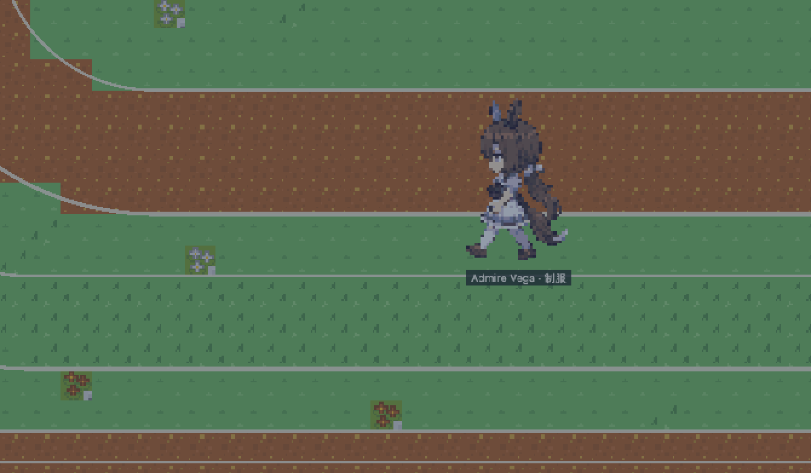

# umamusume-agent-stage

特雷森学院的浏览器端 2D 演出与交互舞台。训练员可以在多张地图间移动，角色能够行走、对话、跟随与留守；同一套舞台既可以响应 [`umamusume-agent`](https://github.com/quantumxiaol/umamusume-agent) 的结构化动作，也可以回放 JSON 短剧。



<p align="center">爱慕织姬 · 夜间训练场运行示例</p>

## 能做什么

- 加载 ChibiWeaver base20 角色包，并切换制服/决胜服；
- 在特雷森学院场景中碰撞行走、A* 寻路、跨 Portal 换图；
- 让角色接近、跟随、停止跟随、转向、沿训练路线行动并显示对白；
- 在角色跟随镜头、固定场景镜头和当前地图全图预览间切换，支持小地图与昼夜天气；
- 查看传送点目的地、独立的世界连接总览，以及逐张地图的出口路线；
- 连接 Agent 进行单人/多人角色扮演，让 Director 根据对话和实时环境返回舞台动作；
- 回放 `PerformanceScript`，或兼容带有额外 `stage` 字段的 `umamusume-anime` JSON。

详细实现清单和阶段边界见 [`docs/current-capabilities.md`](docs/current-capabilities.md)。

## 快速启动

需要 Node.js 24 与 pnpm 11，依赖版本已固定在 `pnpm-lock.yaml`。

```bash
pnpm install
cp .env.example .env
```

本地联调时，在 `.env` 中指向正在运行的 `umamusume-agent`：

```text
UMAMUSUME_AGENT_URL=http://127.0.0.1:1111
UMAMUSUME_AGENT_API_ACCESS_KEY=与 Agent 后端 API_ACCESS_KEY 相同
```

启动 Stage：

```bash
pnpm dev
```

打开 `http://127.0.0.1:4173/`。Agent 不可用时，角色与服装切换、地图移动、寻路、Portal、天气、镜头和 JSON 短剧仍可独立测试。

## 操作

| 操作 | 快捷键或入口 |
| --- | --- |
| 移动训练员 | `W A S D` 或方向键 |
| 显示/隐藏小地图 | `M`，或 CAMERA 区域的“小地图”按钮 |
| 进入/退出当前地图全图预览 | `O`，或 CAMERA 区域的“当前地图全图”按钮 |
| 查看世界连接与换图路线 | `G`，或 MAP 区域的“世界连接总览”；`Esc` / `G` 关闭 |
| 跟随角色/训练员、定镜 | 页面 CAMERA 控件 |
| 角色跟随/停止跟随训练员 | 页面 ACTOR 控件 |
| 昼夜和天气 | 页面 ENV 控件 |

输入框、选择框或可编辑区域聚焦时，地图移动和镜头快捷键不会抢占键盘输入。退出全图预览后会恢复进入前的跟随或定镜状态；小地图开关会在跨地图后保留。

地图里的蓝色（边界）和黄色（图内）传送点会标注“前往哪里”。世界总览显示全部 19 张地图的连接，点选目的地即可查看最少换图路线和每一步的出口位置；它只用于查路，不直接传送或移动角色。总览打开时屏蔽舞台移动按键，关闭后恢复。详见 [`docs/map-coverage.md`](docs/map-coverage.md#传送点与世界导航)。

## Agent 对话与 JSON 短剧

网页从 `.env` 自动连接 Agent，并为所选 cast 建立 Stage 会话。每轮只把当前地图中的角色、Anchor 和实时状态交给 Director；留在其他地图的角色仍属于会话，但不会隔着地图发言或接收动作。协议和动作语义见 [`docs/agent-integration.md`](docs/agent-integration.md)。

“运行兼容 JSON 短剧”会回放 [`content/performances/admire-vega-starlight.anime.json`](content/performances/admire-vega-starlight.anime.json)。原始对白、字幕、音频与立绘字段保持兼容，网页会播放现成 TTS 并按音频实际长度推进字幕；额外的 `stage` 字段负责编排地图、角色行动、镜头和环境。格式见 [`docs/performance-script.md`](docs/performance-script.md)。

## 文档

- [`docs/current-capabilities.md`](docs/current-capabilities.md)：当前能力、内容覆盖、项目结构和已知边界；
- [`docs/architecture.md`](docs/architecture.md)：Runtime 权威、数据流、跨地图 Presence 与技术栈；
- [`docs/agent-integration.md`](docs/agent-integration.md)：Agent Stage API、角色绑定和动作协议；
- [`docs/performance-script.md`](docs/performance-script.md)：JSON 短剧与 anime 兼容格式；
- [`docs/content-pipeline.md`](docs/content-pipeline.md)：角色和地图的制作、同步与校验；
- [`docs/map-coverage.md`](docs/map-coverage.md)：地图覆盖、环境表现和后续打磨顺序；
- [`docs/deployment.md`](docs/deployment.md)：GitHub Pages 与 HF Space 部署。

## 校验

```bash
pnpm check
```

该命令覆盖内容编译、JSON Schema、TypeScript、单元测试和生产构建。

## 版权声明

本项目是非官方、非商业的粉丝工具项目，与 Cygames, Inc. 无关联，也未获得其认可或赞助。《ウマ娘 プリティーダービー》及相关角色、名称和设计的权利归其各自权利人所有。

角色像素素材与特雷森场景扩展由项目作者制作；共享基础 tileset 中使用的 Kenney Roguelike/RPG Pack 为 CC0-1.0，完整来源记录见 [`content/tilesets/tracen-campus/license-manifest.json`](content/tilesets/tracen-campus/license-manifest.json)。
